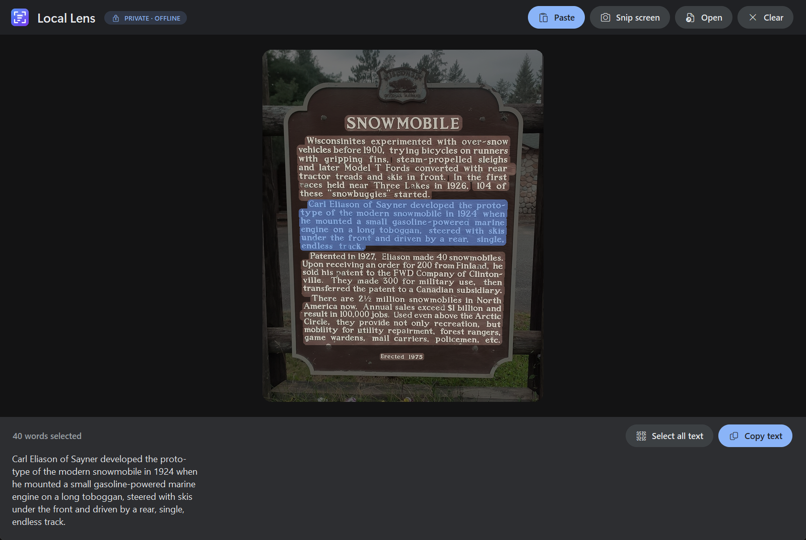
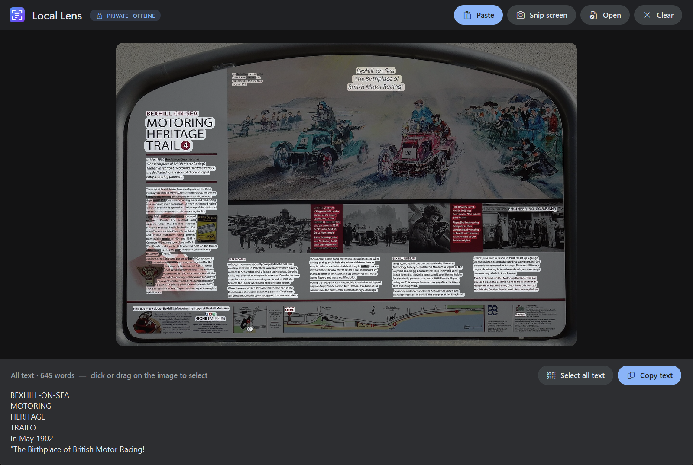

<p align="center">
  
</p>

<h1 align="center">Local Lens</h1>

<p align="center">
  <b>Grab text from any image, privately.</b><br>
  Your screenshots never leave your PC. No cloud, no account, no tracking.
</p>

<p align="center">
  
  
  
  
  
</p>

<p align="center">
  
</p>

## Why Local Lens?

The screenshots you want text from are often the private ones: bank statements, medical letters,
ID documents, work chats, passwords on a sticky note. Most "copy text from image" tools send that
image to a server to read it.

**Local Lens never does.** It uses the OCR engine that already ships inside Windows, so the image
is read on your own machine and goes nowhere else. It even works with your Wi-Fi switched off.

## Privacy, in detail

| | |
| --- | --- |
| 🌐 **No network access** | The app contains no networking code. It never connects to the internet. |
| 🧠 **On-device OCR** | Text is recognized by Windows' built-in `Windows.Media.Ocr` engine, on your CPU. |
| 💾 **Nothing saved** | Images and text stay in memory only. Nothing is written to disk unless *you* click **Save image**. |
| 🧹 **One click to forget** | **Clear** (or `Delete`) drops the image and text from memory immediately. Closing the app does the same. |
| 📊 **No telemetry** | No analytics, no crash reporting, no accounts, no "phone home". |
| 🔍 **Easy to audit** | The whole app is one readable file, [`local_lens.pyw`](local_lens.pyw), about 850 lines. |

**One thing to know:** when you copy text, it goes to the Windows clipboard like any copy does. If
you've turned on **clipboard history sync** (Settings → System → Clipboard → *Sync across your
devices*), Windows itself may sync copied text to your Microsoft account. That's a Windows setting,
not Local Lens, but it's worth checking if you copy sensitive text.

**Check it yourself:** turn off Wi-Fi and use the app. It works exactly the same.

## Features

<p align="center">
  
</p>

- **Paste and go.** Press `Ctrl+V` with a screenshot, a copied image, or a copied image file.
- **Snip the screen.** Use the built-in Windows snipping overlay and the text is read straight away.
- **Text lights up on the image.** Click a word, drag across words, or double-click for a whole line.
- **Box select.** Drag a box on an empty spot to grab everything inside it.
- **Keeps tables tidy.** Selected text is rebuilt row by row, so a receipt label stays next to its
  price, even in a slightly tilted photo.
- **Handles big text.** Large signs and headings get an extra OCR pass at a smaller size, which
  Windows OCR reads more reliably.
- **Select all and copy.** Selections are copied to the clipboard automatically.
- **Drag and drop** image files onto the window.
- **Editable result.** Fix any typo in the text panel before copying.

## Install

Requires **Windows 10 or 11** and **[Python 3.9+](https://www.python.org/downloads/)**.

```powershell
git clone https://github.com/TylerBuza/local-lens.git
cd local-lens
powershell -ExecutionPolicy Bypass -File install.ps1
```

This installs the three Python packages and puts a **Local Lens** shortcut on your Desktop and in
the Start menu. The installer is the only step that uses the internet, to download those packages.

Prefer to run it by hand?

```powershell
pip install -r requirements.txt
pythonw local_lens.pyw
```

## Shortcuts

| Key | Action |
| --- | --- |
| `Ctrl+V` | Paste image |
| `Ctrl+N` | Snip the screen |
| `Ctrl+O` / `Ctrl+S` | Open / save image |
| Click / drag | Select words |
| Double-click | Select a line |
| Drag on empty space | Box select |
| `Ctrl+A` | Select all text |
| `Ctrl+C` | Copy selection |
| `Esc` | Deselect |
| `Delete` | Clear the image from memory |
| Right-click | Menu |

## Languages

Local Lens can read any language you have a Windows OCR pack for. To add one, go to
**Settings → Time & language → Language & region → Add a language**. Once more than one is
installed, a language picker appears in the top bar.

## Limits

Windows OCR is great with printed text in screenshots, documents, signs and labels. It struggles
with handwriting and very stylized lettering.

## How it works

- **OCR:** [`Windows.Media.Ocr`](https://learn.microsoft.com/uwp/api/windows.media.ocr), called
  through [`winocr`](https://github.com/GitHub30/winocr).
- **UI:** Tkinter, with Pillow rendering the highlights.
- **Drag and drop:** [`tkinterdnd2`](https://github.com/Eliav2/tkinterdnd2), optional.

The logo is generated by [`tools/make_icon.py`](tools/make_icon.py), and the screenshots by
[`tools/make_demo.py`](tools/make_demo.py).

## Demo photo credits

Both demo photos are from Wikimedia Commons and released under **CC0** (public domain).

- [Wisconsin Historical Marker 212](https://commons.wikimedia.org/wiki/File:Wisconsin_Historical_Marker_212.jpg) (cropped)
- [Motoring Heritage Trail Information Panel 4, Bexhill-on-Sea](https://commons.wikimedia.org/wiki/File:Motoring_Heritage_Trail_Information_Panel_4,_Bexhill-on-Sea.jpg)

## License

[MIT](LICENSE)
